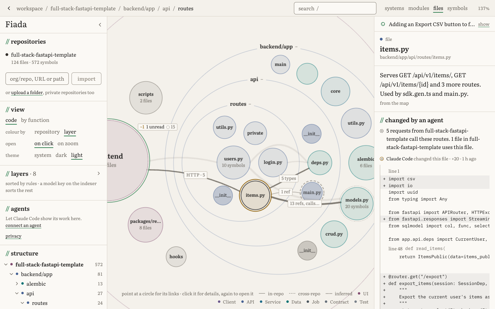
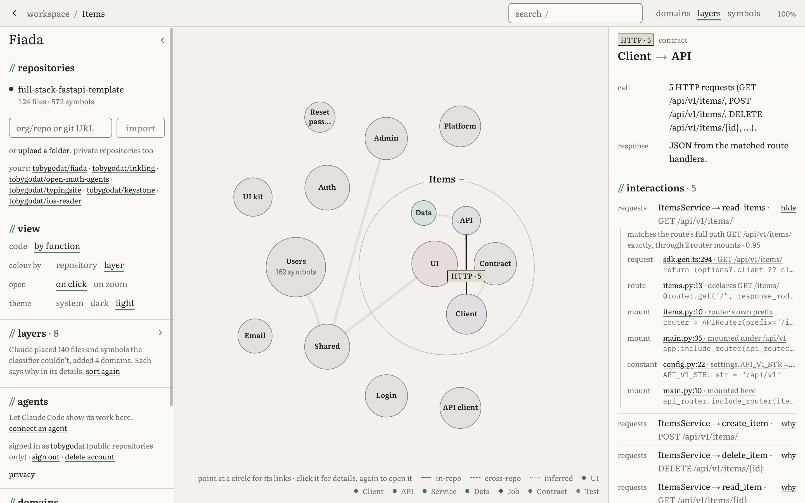
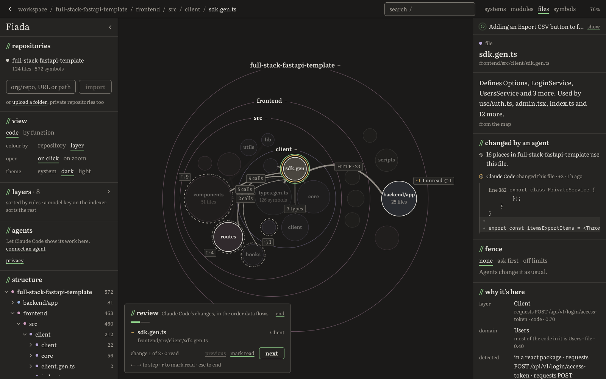
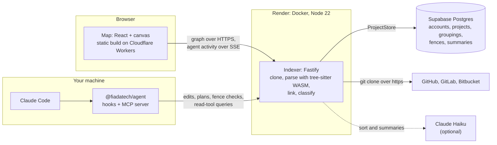

# Fiada

[](https://github.com/tobygodat/fiada/actions/workflows/ci.yml)

Fiada is a map of your codebase that sorts itself, explains itself, and lights up where your coding agent is working. Try it at **[fiada.tech](https://fiada.tech)**, where you sign in with GitHub and get a map of your own.

<picture>
  <source media="(prefers-color-scheme: dark)" srcset="docs/screenshots/map-dark.png">
  
</picture>

The map above is [`fastapi/full-stack-fastapi-template`](https://github.com/fastapi/full-stack-fastapi-template). Circles nest from repository to folder to file to function. The selected file's panel says what it does, what calls it, and what an agent changed in it.

<picture>
  <source media="(prefers-color-scheme: dark)" srcset="docs/screenshots/contract-dark.png">
  
</picture>

The second picture shows the same code **by function**, with the Items feature split into layers. The link from Client to API stands for 5 HTTP requests, and **why** shows the code behind the first one.

Fiada was built at HackGT 13, where it won first place in ML/AI Visualization.

## What it does

- **Sorts the code on import.** Rules place each file and function they can in a layer (UI, Client, API, Service, Data and others) and a feature domain. Domains start from routes, ORM models and folder names and spread along the call graph. With a model key, the model names the domains and places what the rules left over, with a one-line reason for each. On fiada.tech, Claude Haiku placed 140 files and symbols in the FastAPI template and added 4 domains.
- **Shows the evidence for each link.** Each import, call, route match and HTTP request that Fiada records is marked evidenced (the code names its target) or inferred (a heuristic matched it), with a confidence, a reason and the lines of code behind it. A link that is only inferred is dotted.
- **Shows the contract between two parts.** Click a link to open its contract, which lists the interactions behind it. HTTP requests are matched to the routes they call, through router prefixes and mounts, within a repository or across repositories.
- **Shows Claude Code working.** Its hooks report each edit from git, and the map rings what it added, changed or deleted, with the diff one click away. Mark a circle **ask first** or **off limits**, and Claude Code asks you or refuses before one of its edit tools changes code inside it. Shell commands are not checked ([fences](docs/CODING-AGENTS.md#fences-and-collisions)).
- **Answers the agent's questions, then walks you through its work.** The MCP server gives Claude Code three read tools, `where_is`, `who_uses` and `impact`, answered from the map with file and line evidence. **review** steps through the functions and files the agent changed, in the order data flows: page, client, route, table.



## How it works



The indexer parses 12 languages with tree-sitter compiled to WebAssembly, then resolves imports, router mounts and URL templates into edges. That is how the generated client's `GET /api/v1/items/` finds FastAPI's `@router.get("/")` under `APIRouter(prefix="/items")` and an `/api/v1` mount. The map draws to a canvas that owns the camera, so in the default click mode, zooming and panning never re-render React. The agent hook reads changes from git rather than from the tool input, so it also catches files that a shell command deletes or moves. Render's free disk is wiped on every restart, so projects live in Postgres and the indexer clones repositories again when a project opens ([ADR 0004](docs/adr/0004-render-and-supabase.md)).

## Run it locally

Use Node 22 or later (the version CI and the container use), [bun](https://bun.sh) 1.4 or later, and git.

```sh
git clone https://github.com/tobygodat/fiada && cd fiada
bun install
bun run dev    # indexer on :4178, map on http://localhost:5178
```

Open http://localhost:5178 and click **fastapi/full-stack-fastapi-template** under the import box to import it. To import something else, type an `org/repo`, a git URL or a local path and press **import**. [A first tour](docs/USING.md#a-first-tour) says what to try next.

No key or variable is needed. To change a setting, copy `.env.example` to `.env` at the repository root. These are the variables that matter most:

| Variable | What it does |
| --- | --- |
| `ANTHROPIC_API_KEY` or `OPENAI_API_KEY` | Turns on the model sort and generated summaries. Without a key, the rules sort the code and summaries are lines built from the graph. |
| `DATABASE_URL` | Saves projects to Postgres instead of `.fiada/` on disk. |
| `FIADA_GITHUB_CLIENT_ID`, `FIADA_GITHUB_CLIENT_SECRET` | Turns on GitHub sign-in, with a private project for each person. |

[Configuration](docs/HOSTING.md#configuration) lists every variable.

## Connect Claude Code

With `bun run dev` running, import the repository you work in by its absolute local path, so that edits re-index in place. Then run:

```sh
bun run agent:setup --write /path/to/your/repo
cd /path/to/your/repo && claude
```

`--write` adds Fiada's hooks, and a rule that lets Claude Code call Fiada's tools without asking, to the repository's `.claude/settings.local.json`. It also registers the `fiada` MCP server with `claude mcp add`. On fiada.tech, **connect an agent** in the sidebar gives one `npx` command with your token, so no checkout of Fiada is needed. [Coding agents](docs/CODING-AGENTS.md) covers Cursor, Codex and scripts.

## Stack and quality

- **Runtime.** bun 1.4 installs dependencies and runs the scripts. Node 22 runs the indexer, the agent and the tests ([ADR 0003](docs/adr/0003-node-runs-the-code.md)).
- **Code.** TypeScript in four workspaces: `shared` (the graph types), `indexer` (Fastify and web-tree-sitter), `web` (React 19, Vite and a canvas renderer) and `agent` (published to npm as [`@fiadatech/agent`](agent/README.md)).
- **Lint.** oxlint with the anti-slop plugin, with warnings treated as errors (`.oxlintrc.json`).
- **Tests.** `node:test` beside the code, run with `bun run test`. CI also runs the Postgres store tests against a real Postgres.
- **CI.** GitHub Actions runs typecheck, lint, test and build on every pull request and every push to `main`. Cloudflare Workers Builds deploys `main` to fiada.tech and builds a preview of the map for each pull request branch.

## Docs

- [docs/ARCHITECTURE.md](docs/ARCHITECTURE.md): the code map, the indexer pipeline, data and external services.
- [docs/CONVENTIONS.md](docs/CONVENTIONS.md): how to run, test and change the code.
- [PRODUCT.md](PRODUCT.md) and [DESIGN.md](DESIGN.md): who it is for, and the design system.
- [docs/adr/](docs/adr/): decisions on storage, hosting and runtimes.
- [docs/USING.md](docs/USING.md): importing, reading the map, layers, the model sort and summaries.
- [docs/CODING-AGENTS.md](docs/CODING-AGENTS.md): the agent overlay, the read tools, fences, and Cursor and Codex.
- [docs/HOSTING.md](docs/HOSTING.md): hosting, storage, GitHub sign-in, every variable and how to deploy.
- [docs/demo-script.md](docs/demo-script.md) and [docs/devpost.md](docs/devpost.md): the HackGT demo and write-up.

## License

MIT. See [LICENSE](LICENSE).
