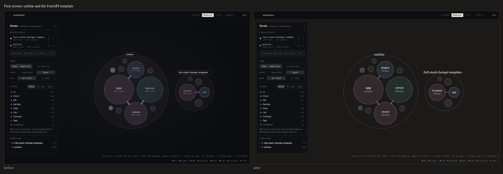
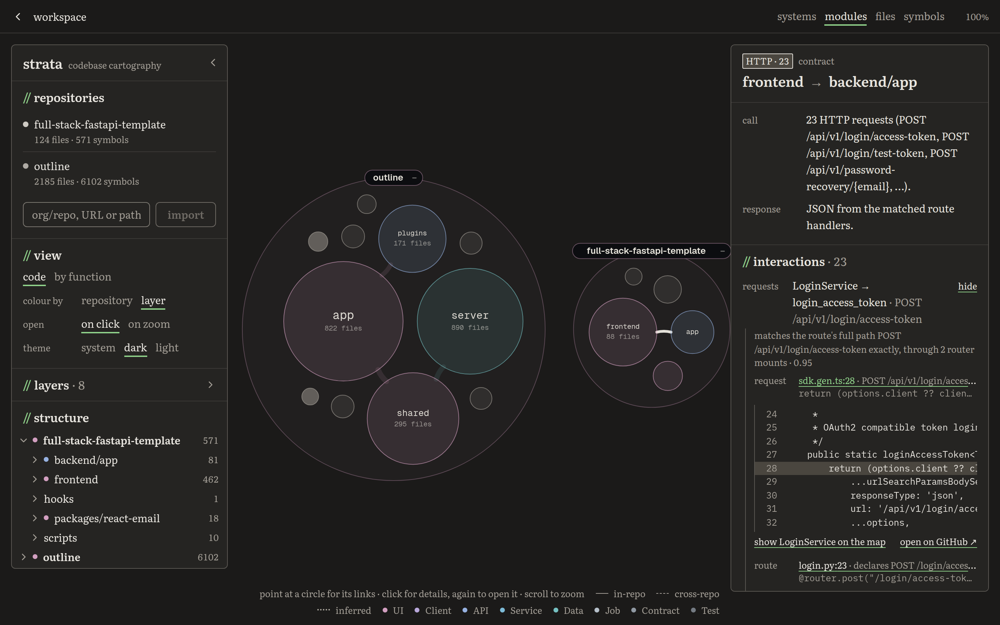
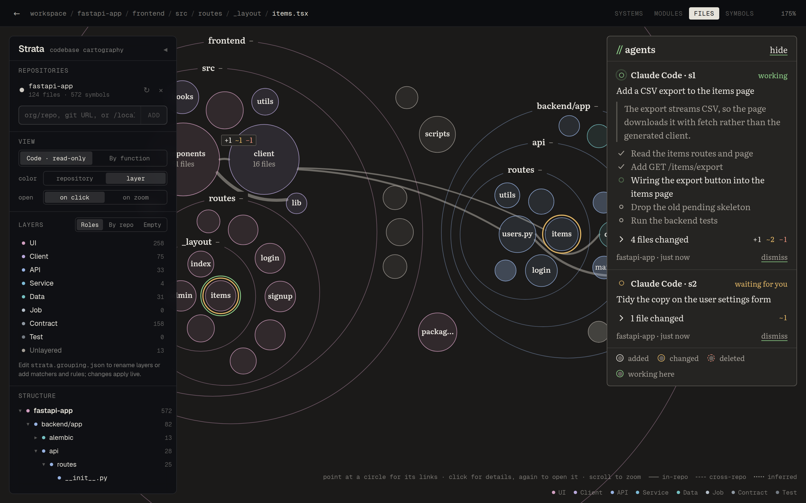
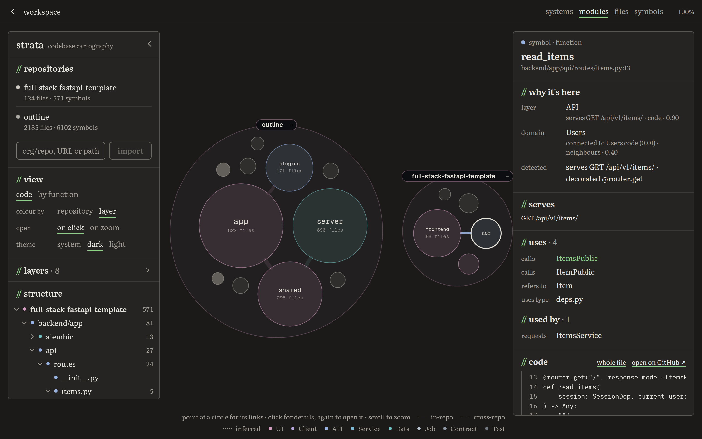

# Fiada

A map of your codebase that sorts itself, explains itself, and lights up where your coding agent is working.

Reading code file by file loses the big picture, and a one-paragraph architecture summary can't tell you what a change touches. Fiada sits in the middle. It turns one or more real repositories into a single zoomable map: circles nest from repository to folder to file to function, and the lines between them are contracts (imports, calls, HTTP requests, shared models), each with the code that proves it. Connect Claude Code and every file and function it touches rings on the map as it works, so you review agent work where it lives in the system instead of in a wall of diff.

**Try it:** https://hackgt13.vercel.app (hosted, read-only) · [demo script](docs/demo-script.md) · [Devpost write-up](docs/devpost.md)

Built at HackGT 13 for the Oracle of the Deep track (ML/AI + visualization).



## What it does

- **Sorts the code for you on import.** Every file and function lands in a layer (UI, Client, API, Service, Data, ...) and a feature domain (Items, Users, Login). Rules seed the domains from routes, ORM models and folder names and follow the call graph from there; Claude names the domains, merges duplicates and places what the rules couldn't, each with a one-line reason.
- **Says what each circle does.** Selecting a node shows a short generated summary above its calls and callers, cached by content hash.
- **Separates what it knows from what it guessed.** Every contract lists the lines of code behind it. Links the indexer only inferred are dotted, with a `?`, a confidence and a reason.
- **Shows your coding agent working.** Claude Code's hooks and an MCP server report each edit; the map rings what was added, changed or deleted, counts changes on closed circles, and shows the diff when you click.
- **Two views of the same code.** **Code** is the structure as it is on disk. **By function** regroups the same functions by feature, then layer, so a feature that spans a React page, a generated client, a FastAPI route and a table reads as one circle.

| Following an HTTP contract to the code behind it | An agent at work: rings, counts, task and plan |
| --- | --- |
|  |  |



## Run it locally

Needs Node 20.19 or later and git.

```sh
git clone https://github.com/tobygodat/hackgt13 && cd hackgt13
npm install
npm run dev          # indexer on :4178, map on http://localhost:5178
```

Open http://localhost:5178, type `fastapi/full-stack-fastapi-template` in the box under **repositories**, and press **import**. For a private repository, use **upload a folder** under the box instead: the browser sends only the source files (it honours `.gitignore` and skips `node_modules` and the git history), up to 50 MB. Then:

1. Click a circle to see what it is; click it again to open it.
2. Under **view**, switch to **by function** and open the **Items** domain.
3. Click the **HTTP** tag between Client and API to read the contract, and click either end of an interaction to jump to its code.

Optional, in a `.env` at the repo root (`.env.example` lists them):

- `ANTHROPIC_API_KEY` turns on the AI sorting and the generated summaries. Without it, Fiada still sorts by rules and writes plain one-line summaries.
- `MONGODB_URI` saves projects to MongoDB Atlas instead of `.fiada/` on disk. See [MongoDB Atlas](#mongodb-atlas).

## Connect a Claude Code session

Import the repository you'll work in by its local path (so edits re-index in place), then:

```sh
npm run agent:setup -- --write /path/to/your/repo
cd /path/to/your/repo && claude
```

`--write` adds Fiada's hooks to that repo's `.claude/settings.local.json` and registers the Fiada MCP server with `claude mcp add`. Give Claude a task and watch the map: its task and plan appear in the agents window, and each file or function it touches gets a ring. If you start `claude` from inside another Claude Code session, `unset CLAUDE_CODE_SESSION_ID` first. Cursor, Codex and scripts are covered in [Watching a coding agent](#watching-a-coding-agent).

## Hosted demo

The map is at https://hackgt13.vercel.app, a static build on Vercel. It talks to the indexer at https://strataindexer-production.up.railway.app, a Docker container on Railway, which stores each project's repositories and grouping in MongoDB Atlas. Anyone can browse it; adding repositories needs the project's key. [Deploy](#deploy) explains the split.

## Using the map

Open http://localhost:5178 and add a repository in the sidebar. Anything git can clone works (`org/repo`, `github.com/org/repo`, an https or ssh URL), and so does an absolute path to a local checkout, which is read in place. For a private repository, or any folder the indexer can't reach, **upload a folder** under the import box: the browser walks it and sends only the source the indexer reads (up to 50 MB), leaving behind whatever its `.gitignore` files ignore, `node_modules` and the other dependency and build folders, and the git history. The indexer unpacks that into its own storage and indexes it like a clone, keeping the folder's `origin` remote, branch and HEAD from its `.git` so agents working in the real checkout still find it. Uploading the same folder again (same remote, else same name, or **upload again** on its row) replaces it. Add several and they share one map; imports, calls and HTTP requests that cross repositories become dashed edges.

Until you point at something the map draws only a few links: each open circle's strongest two or three, at most six in all (HTTP requests and cross-repository links count for more), untagged. That holds at every depth, so opening a big circle shows its own few key links rather than everything crossing its rim. Point at a circle, or select it, to see its strongest eight links, tagged with what they are ("HTTP · 23", "552 calls +40"); its tooltip says when more were left off, and its panel lists them all. (`?links=all` in the URL draws every link and tag, `?links=none` none until you point; the rules live in `web/src/render/edges.ts`.) Click a circle to select it: the detail panel says what it is, what it depends on and what depends on it. Click it again (or press Enter) to open it in place: its neighbours stay on screen as small closed circles, and edges reattach to the specific file or symbol inside that each one comes from. Click an open circle's name tab (or a breadcrumb) to close it again. Scroll only zooms and drag pans; neither opens or closes anything. Click an edge or its tag to read the contract between two parts, and click either end of any interaction listed there to go straight to the code responsible. Each interaction's **why** lists the code behind it (the request, the route and router mounts it matched, the import or call) and clicking a line shows that code in place. Contracts the indexer only guessed are dotted, with a `?` on their tag, and interactions it recorded without the code behind them say "no evidence found". The detail panel shows the selected file's or symbol's code. Back (the ← button, or Backspace) returns to where you were; Esc clears the selection.

The sidebar's **open** setting switches to the prototype's semantic zoom, where circles open by themselves as you zoom into them.

## How it's put together

```
shared/    the graph contract (nodes, edges, layers, agent events) both sides import
indexer/   clone → parse → link → classify → graph, behind a small HTTP API
web/       React app: canvas map, floating sidebar, detail panel, task queue
agent/     what a coding agent runs: a stdio MCP server and a tool-hook CLI
```

The indexer pipeline:

1. **Sources** (`indexer/src/sources.ts`): lists files with `git ls-files`, skips vendored and generated directories and (by default) tests, and reads `package.json`, `tsconfig*.json`, `pyproject.toml` and `requirements*.txt`.
2. **Parse** (`indexer/src/parse/`): tree-sitter (WASM, no native build) extracts imports, top-level symbols, the identifiers each symbol uses, server routes and the routers they hang off, client HTTP requests, client page routes (React Router, TanStack Router) and ORM links (SQLAlchemy relationships and foreign keys, GORM fields). TypeScript, TSX, JavaScript, Python and Go today; a language is a grammar plus one extractor.
3. **Link** (`indexer/src/link.ts`): resolves imports (relative paths, tsconfig `paths`, workspace packages, Python packages, Go modules, across every imported repo), binds identifiers to the symbols they name through re-exports and barrels, follows router mounts (`include_router`, `register_blueprint`, `app.use`, gin groups) to give every route its full path, and matches requests like `fetch(\`${API}/items/${id}\`)` to routes like FastAPI's `@router.get("/{id}")` under `APIRouter(prefix="/items")`. Every edge records the code behind it (file, line and that line's text) and whether it's **evidenced** (the code names the target, or a request's full path equals the route's) or **inferred** (a heuristic linked them, such as a URL that only matches a route's tail), with a confidence and a one-line reason.
4. **Facts** (`indexer/src/facts.ts`): detectors turn what the parser saw into language-neutral facts on every file and symbol: the routes it serves, the requests it makes, JSX, ORM tables, base classes, decorators, imports, and whether it's type-only.
5. **Build** (`indexer/src/build.ts`): emits the node tree (single-child folder chains collapsed) and edges.
6. **Classify** (`indexer/src/classify/`): places every file and symbol in one of the project's layers and a domain, each with evidence. This step only reads facts, paths and edges, so a grouping change reclassifies in milliseconds without re-parsing.

The web app rebuilds the tree for the chosen view and decides which circles are open: the ones you opened (click mode), or the ones big enough on screen (zoom mode). It packs only the open part of the tree, giving each closed circle a compact size so an opened one grows and its neighbours stay visible, and lifts every edge to the nearest visible ancestor of each end, so edge thickness follows the number of underlying interactions. Each edge bends whichever way takes it through the fewest closed circles, worked out once per layout. Edges are resolved to tree indices once per graph, so re-lifting them when something opens takes a couple of milliseconds even on next.js.

The map draws to a canvas (`web/src/render/renderer.ts`), which owns the camera, animation, pointer input and hit testing; React hands it a new scene only when what's open or selected changes, so zooming and panning never re-render the app. The SVG map it replaced dropped to 15–20 fps on next.js (13k nodes, 10k edges), with stalls of up to 1.7 s whenever circles opened, most of it the browser painting SVG and label DOM.

## Layers are per project

Each project defines its own layers. A layer is an id, a name and a list of matchers; a matcher names a fact, an imported package, a path glob or a whole repo (every field it sets must match) and a priority. Across all of a project's layers, the highest-priority match wins:

```json
{
  "id": "api",
  "name": "API",
  "rank": 3,
  "match": [
    { "fact": { "type": "route" }, "priority": 300 },
    { "import": "fastapi", "priority": 200 },
    { "path": "**/controllers/**", "priority": 100 }
  ]
}
```

Files nothing matches take the layer most of their callers have; anything still unplaced lands in **Unlayered**, which the sidebar counts so you can see what needs a rule. Symbols inherit their file's layer unless one of their own facts matches (a schema class in a models file, a fetch helper in a component file).

A new project starts from a preset, which is just data you then own:

| Preset | Layers |
| --- | --- |
| `roles` (default) | UI, Client, API, Service, Data, Job, Contract, Test, matched by code facts first (routes, JSX, ORM tables, requests), then imports, then file and folder names |
| `by-repo` | one layer per repository |
| `empty` | none; everything starts Unlayered |

The grouping lives in `.fiada/projects/default/fiada.grouping.json`. Edit it to rename layers, add matchers, or add `rules` (bulk moves by path, symbol name or current layer) and `pins` (single files or symbols); edits apply live, and the sidebar shows an error if the file doesn't validate. The sidebar also switches presets, and the detail panel shows why each file and symbol landed where it did.

Domains (the features that cut across layers and repos) come from the classification design's seed-and-propagate strategy (`indexer/src/classify/propagate.ts`). Routes (`GET /items/{id}`), ORM entities (`class Item`), page routes, and files in structural folders (`routes/items.py`, `components/Items/`) seed a domain when two or more files agree on it. Everything else takes the domain of the code it's connected to through calls, HTTP requests, renders and imports. A close split goes to **Shared**, and so does code that three or more features use directly. Code with no path to any seed joins the majority of its file, and anything left over is **Unsorted**. Domain pins in the grouping file act as seeds too, so they pull their unclaimed neighbours along. The older `feature-tokens` strategy is still available; strategies are swappable in `indexer/src/classify/index.ts`.

### Sorted on import

With `ANTHROPIC_API_KEY` set, a fresh import doesn't stop at the classifier. Once every repository is indexed, the indexer asks Claude (`indexer/src/classify/model-sort.ts`, off the request path) to finish the job in two steps:

1. **Domains.** Claude sees each domain the classifier found (its files, what seeded it, its biggest symbols) and an outline of what's left over. It gives each a plain product name, merges domains that are one feature ("Shares" and "Sharing"), and adds the few domains the leftovers need ("Platform").
2. **Leftovers.** Every file with code in Unlayered or Unsorted goes to Claude in batches, with its imports, detected facts, symbols, and the domains and layers of the code around it. Claude picks one of the project's layers and a domain, with a one-line reason.

The result is saved in the grouping as `sorted`, through the same `ProjectStore`, and the map redraws when it lands. It only fills gaps: code the classifier placed keeps its place, and your renames, rules and pins win over it, so you adjust from a sorted map exactly as before. Each placement Claude made shows its reason in the detail panel, marked as inferred. A new repository or commit sorts again; the sidebar's **sort again** does it on demand (`POST /api/grouping/sort`). Delete `sorted` from the grouping to drop it. Without a key, imports keep the classifier's result and the sidebar says sorting is unavailable.

`npm run index -- <repos> --sort` runs the same sort from the command line and prints how much was left unsorted before and after.

## Node summaries

The first thing under a selected node's name in the detail panel is what it does. Every node gets a line straight away, built from what the indexer knows ("Handles POST /api/v1/items/. Called over HTTP by ItemsService.", "Defines list_items, create_item and unused. Used by items.py.") and led by the first sentence of the code's own docstring or doc comment when it has one. With `ANTHROPIC_API_KEY` set on the indexer, Claude writes one or two sentences per node from its code and neighbours, through the same client the sort uses (`indexer/src/llm.ts`), marked "generated" with the model's name. Its uses and used-by lists sit folded under the summary with their counts.

Generated summaries are written in batches, off the request path: after each import or re-index, files first, then folders (deepest first, each reading its children's summaries), domains and their layers, then repositories; a symbol's whole file is written in one request when one of its symbols is first selected. Each summary is cached under a hash of what the model read and saved through the `ProjectStore`, so a restart costs nothing and a re-index rewrites only what changed and what contains it. `npm run index -- <repo> --summaries` prints sample lines and how many requests a fresh import would make, without calling a model: the FastAPI template takes 11 requests for 197 summaries of files, folders, groups and the repository (about 29,000 input tokens), and outline 70 requests for 2,566 (about 430,000); symbols cost one request per file, only as files are opened. The code lives in `indexer/src/summaries/`.

## Storage

Everything a project keeps (its repositories, its grouping and its generated summaries) goes through the `ProjectStore` interface in `indexer/src/store.ts`. The default `FileProjectStore` writes under `.fiada/projects/<id>/`. When `MONGODB_URI` is set, `createStore()` picks `MongoProjectStore` (`indexer/src/mongo-store.ts`) instead. The graph itself is always derived, never stored.

### MongoDB Atlas

With Atlas, each project is one document in the `projects` collection, keyed by project id, with the repo list and the grouping side by side. Restarting the indexer, or running it on another machine with the same connection string, brings the project back.

1. In [Atlas](https://cloud.mongodb.com), create a free cluster, then a database user under **Database Access**.
2. Under **Network Access**, allow your IP address.
3. Under **Connect > Drivers**, copy the connection string, put your user's password in it, and save it as `MONGODB_URI=...` in a `.env` file at the repo root (gitignored; `.env.example` lists the variables).
4. `npm run dev`. The indexer logs `saving projects to MongoDB at …`, never the password.

If Atlas can't be reached or read at startup, the indexer says why and saves under `.fiada/` for that run, so the map still works offline. Clones and parsed code stay on local disk either way.

Two indexers can serve one project. Saving the repo list never touches the grouping and vice versa, and each carries a revision: if another indexer saved after this one loaded, the save is refused with a message to restart instead of silently undoing the other's change. Grouping edits made elsewhere don't apply live the way edits to `fiada.grouping.json` do; restart to pick them up. MongoDB field names can't contain dots and symbol ids do, so `.`, `$` and `%` in keys are percent-escaped in the database and restored on load.

To see classification results without the UI:

```sh
npm run index -- ../some-repo org/other-repo --layers --domains
npm run index -- ../some-repo --preset by-repo
npm run index -- ../some-repo --grouping my.grouping.json --layers
```

## Watching a coding agent

Fiada can follow a coding agent (Claude Code, Cursor, Codex, or anything that speaks MCP) while it works on a repository you've imported. A small window at the top right lists each agent's task and plan, with the step it's on, and the map marks what it touches: a ring just outside anything it added (ink), changed (ochre) or deleted (dashed brick), and a short pulse as each change lands. Those colours only ever mean a change on the map; in the window, a green dot means the agent is working and an ochre one means it's waiting for you. A closed circle shows a count of the changes inside it (`+2 ~3 −1`: files in the Code view, symbols By function) on whichever side of it is clear of links and tags, so you can see where an agent is working without opening anything. Click a changed file in the window, or any ringed circle, and the detail panel shows the diff (for a symbol, just the hunks that touch it).

There are two ways in, and they work best together:

- **Hooks** (deterministic). The agent's own tool hooks run `agent/bin/fiada-hook.mjs` after every edit, so changes show up even when the agent never mentions them. The hook asks git about the agent's working tree: edited files come with their changed lines and a diff against HEAD, and after a shell command it compares the tree with the last call, so files removed with `rm` or `git mv`, generated files and reverts are caught too. Changes already in the tree when the agent started, or made by you between prompts, aren't put on the agent. Claude Code's plan (`TodoWrite`, or `TaskCreate`/`TaskUpdate`) becomes the step list, and your prompt is the task until the agent names its own.
- **MCP** (the agent's own words). `agent/bin/fiada-mcp.mjs` is a stdio MCP server with two tools: `report_task` (the task, the plan as steps marked `pending`, `active` or `done`, the step it's on, a note) and `flag_changes` (files or folders `added`, `modified` or `deleted`, optionally with the functions or classes it touched). Its instructions ask the agent to call them as it goes; the hook covers whatever it forgets.

Both post to the indexer's `/api/agent/events`. A file maps to the graph by path when its repository was imported from a local directory, or by `origin` remote (then folder name) when the agent works in another checkout of an imported repository. When the agent edits a repository Fiada reads in place, the indexer re-parses just the changed files and relinks (about 10 ms on the FastAPI template), so new files and symbols appear on the map, and comparing each file's symbols with HEAD says which functions were added, changed or deleted. The map fetches the new graph without moving the camera. Agent activity isn't stored anywhere; dismissing an agent in the window clears its marks.

Each session is its own card, even when two run in the same checkout. The MCP server finds its session from `CLAUDE_CODE_SESSION_ID`, which Claude Code sets for the servers it starts; for other clients, from the parent process it shares with that session's hooks. A file that only turned up when one session compared the working tree goes to whichever session's own tool wrote it.

### Claude Code

```sh
npm run agent:setup                                   # prints the two snippets below with this checkout's paths
npm run agent:setup -- --write /path/to/your/project  # or writes them for you
```

`--write` merges the hooks into `/path/to/your/project/.claude/settings.local.json` (your own, git-ignored settings; other hooks there are kept) and registers the MCP server for that project with `claude mcp add`. To do it by hand, add the server:

```sh
claude mcp add fiada -- node /path/to/hackgt13/agent/bin/fiada-mcp.mjs
```

and the hooks, in `.claude/settings.local.json`, `.claude/settings.json` (shared with your team) or `~/.claude/settings.json` (every project):

```json
{
  "hooks": {
    "SessionStart": [{ "hooks": [{ "type": "command", "command": "node /path/to/hackgt13/agent/bin/fiada-hook.mjs", "timeout": 10 }] }],
    "UserPromptSubmit": [{ "hooks": [{ "type": "command", "command": "node /path/to/hackgt13/agent/bin/fiada-hook.mjs", "timeout": 10 }] }],
    "PostToolUse": [
      {
        "matcher": "Edit|Write|MultiEdit|NotebookEdit|Bash|TodoWrite|TaskCreate|TaskUpdate",
        "hooks": [{ "type": "command", "command": "node /path/to/hackgt13/agent/bin/fiada-hook.mjs", "timeout": 10 }]
      }
    ],
    "Stop": [{ "hooks": [{ "type": "command", "command": "node /path/to/hackgt13/agent/bin/fiada-hook.mjs", "timeout": 10 }] }],
    "SessionEnd": [{ "hooks": [{ "type": "command", "command": "node /path/to/hackgt13/agent/bin/fiada-hook.mjs", "timeout": 10 }] }]
  }
}
```

Then run `npm run dev`, import the repository you're working in by its local path (so edits re-index), and start Claude Code there. The hook never blocks or fails the agent: it gives up on the indexer after 1.5 s, always exits 0, and prints nothing Claude reads. It takes about 0.2 s per call on Node 22.18 or later, which runs the TypeScript directly; older Node goes through tsx and adds about 0.3 s.

### Other agents

- **Cursor**: add the MCP server in `.cursor/mcp.json` (`{ "mcpServers": { "fiada": { "command": "node", "args": ["/path/to/hackgt13/agent/bin/fiada-mcp.mjs"] } } }`) and the hook in `.cursor/hooks.json` under `afterFileEdit`, `beforeSubmitPrompt` and `stop` (`{ "version": 1, "hooks": { "afterFileEdit": [{ "command": "node /path/to/hackgt13/agent/bin/fiada-hook.mjs" }], … } }`). The hook recognises Cursor's payloads by their `conversation_id` and `workspace_roots`.
- **Codex CLI**: add the MCP server under `[mcp_servers.fiada]` in `~/.codex/config.toml` (`command = "node"`, `args = ["/path/to/hackgt13/agent/bin/fiada-mcp.mjs"]`), and set `notify = ["node", "/path/to/hackgt13/agent/bin/fiada-hook.mjs", "codex"]` so each finished turn sweeps the working tree for changes (the first one counts what changed since Codex started).
- **Anything else**, scripts included: `fiada-hook changed <file>… [--kind added|modified|deleted]`, `fiada-hook task "Add tags" --step "Add the model"`, `fiada-hook sweep` (whatever changed in the working tree since the last call) and `fiada-hook done`, with `--client <name>` to name the agent.

The Cursor and Codex payloads are handled as their docs describe them; only Claude Code has been run end to end. Set `FIADA_HOOK_LOG` to a file to record every payload the hook receives.

## Configuration

Fiada used to be called Strata. Every `FIADA_*` variable is also read under its old `STRATA_*` name (the old name wins if both are set), a checkout that already has a `.strata/` folder keeps using it, and the MongoDB database is still called `strata` by default, so existing deployments keep working unchanged.

| Variable | Default | |
| --- | --- | --- |
| `PORT` | `4178` | indexer port (the web dev server proxies `/api` to it; set `FIADA_INDEXER_PORT` for the proxy if you change it) |
| `HOST` | `127.0.0.1` | address the indexer listens on (`0.0.0.0` in the container, and by default on Railway, Render and Fly) |
| `FIADA_HOME` | `.fiada/` (or `.strata/` if that exists) | where clones and project files live |
| `FIADA_PROJECT` | `default` | which project the indexer serves |
| `MONGODB_URI` | unset | save projects to MongoDB (Atlas) instead of `.fiada/projects/`; see [MongoDB Atlas](#mongodb-atlas) |
| `FIADA_MONGODB_DB` | `strata` | database that holds the `projects` collection |
| `FIADA_SUMMARIES` | on | `off` writes no generated [node summaries](#node-summaries) even with a key set; the lines stay |
| `FIADA_INCLUDE_TESTS` | off | set to `1` to index test files |
| `FIADA_MAX_FILES` | `4000` | per-repo file budget; the shallowest files are kept |
| `FIADA_GITHUB_TOKEN` | unset | token for private GitHub repos, passed per git command and never written to disk |
| `FIADA_UPLOAD_MB` | `50` | most megabytes of source one folder upload may carry (20,000 files at most) |
| `ANTHROPIC_API_KEY` | unset | lets the indexer sort each import with Claude and write [node summaries](#node-summaries); see [Sorted on import](#sorted-on-import) |
| `FIADA_LLM_MODEL` | `claude-opus-5` | the model it sorts and summarises with |
| `FIADA_ALLOWED_ORIGINS` | unset | comma-separated origins whose pages may call the API (the map hosted elsewhere); `*` in an entry matches one run of letters, digits and hyphens |
| `FIADA_API_KEY` | unset | when set, anything that changes the project (imports, layers, agent events) needs `Authorization: Bearer <key>`; reads stay open |
| `FIADA_ALLOW_LOCAL` | on for `127.0.0.1` | `1` or `0`: whether local folders can be imported. Off by default when `HOST` isn't loopback |
| `VITE_API_URL` | unset | build time, web: the indexer's URL when the map is served apart from it; unset, the map calls its own origin |
| `FIADA_URL` | `http://127.0.0.1:4178` | where the agent hook and MCP server send events |
| `FIADA_API_KEY` (agent) | unset | the hook and MCP server send it to a hosted indexer that has one |
| `FIADA_AGENT_STATE` | `$TMPDIR/fiada-agent` | where the hook keeps each session's last view of the working tree |
| `FIADA_HOOK_LOG` | unset | append every payload the hook receives to this file, one JSON object per line |

The indexer also reads a `.env` file at the repo root; variables already set in your shell win.

The indexer binds to 127.0.0.1 by default: importing a local path reads that directory, so on your own machine it's a single-user tool. [Deploy](#deploy) covers running it where others can reach it.

## Deploy

The map is a static build; the indexer is a long-running server that clones repositories to disk, parses them with tree-sitter, keeps the graph in memory and streams agent activity. So they live apart: **the map on Vercel, the indexer in a container** on a host that runs one (Railway, Fly.io or Render; the `Dockerfile` at the root works on each). Vercel's functions are short-lived and stateless, with no git and nowhere to keep clones, so the indexer can't run there.

```
browser ── https://hackgt13.vercel.app ──────── static map (web/dist)
   └────── VITE_API_URL ── https://<indexer> ── indexer container ── MongoDB Atlas (repos, layers)
                                                     └── /data: clones
```

### 1. The indexer (Railway, for example)

New project, **Deploy from GitHub repo**, pick this repository; Railway builds the root `Dockerfile`. Railway may offer a service for every package in the workspace: keep only `@strata/indexer` (the map is on Vercel and the agent runs beside your editor), and clear its custom start command so the `Dockerfile`'s runs. Then set the service's variables and, under **Networking**, generate a public domain on port 4178.

| Variable | Value |
| --- | --- |
| `PORT` | `4178` |
| `MONGODB_URI` | the Atlas connection string, as in `.env` |
| `FIADA_PROJECT` | a project of its own, e.g. `demo`, so it doesn't share (and fight over) the repo list with the indexer on your laptop, whose local folders it can't read |
| `FIADA_ALLOWED_ORIGINS` | `https://hackgt13.vercel.app,https://hackgt13-*-toby-godats-projects.vercel.app` (production and previews) |
| `FIADA_API_KEY` | a long random string (`openssl rand -hex 24`); without it anyone with the URL can import repos into your project or remove them |
| `FIADA_GITHUB_TOKEN` | only to import private repos by URL; uploading the folder from the map needs no token. Either way reads need no key, so anyone with the map's URL can read their code |
| `ANTHROPIC_API_KEY` | to sort each import with Claude and write node summaries; without it the map keeps the classifier's result and one-line summaries |

In Atlas, **Network Access** must allow the host: Railway has no fixed outbound addresses on its standard plans, so that means `0.0.0.0/0`. The container starts with `HOST=0.0.0.0` and `FIADA_HOME=/data`, runs as the `node` user, and turns local folder imports off. With `MONGODB_URI` set, a fresh container re-clones the project's repositories on start, so no volume is needed; mount one on `/data` to skip that (on Railway, also set `RAILWAY_RUN_UID=0` so it can write there). Uploaded folders are the exception: their files live only on the indexer's disk, so without a volume every deploy loses them, and their rows say to upload the folder again. It idles at about 100 MB and used about 200 MB with the FastAPI template and Excalidraw indexed, so 512 MB is enough.

Check it: `curl https://<indexer>/api/workspace` should answer with `"access":{"localPaths":false,"keyRequired":true}`.

On Fly.io: `fly launch` (it finds the Dockerfile; internal port 4178), then `fly secrets set MONGODB_URI=… FIADA_API_KEY=…` and the rest. Render's free instances sleep when idle and take a while to wake, which a demo will notice.

### 2. The map (Vercel)

`vercel.json` already has the build: install the web workspace, `npm run build`, serve `web/dist`. The one setting to add is in **Settings > Environment Variables**:

| Variable | Value | Environments |
| --- | --- | --- |
| `VITE_API_URL` | `https://<indexer>` (the domain from step 1, no trailing path) | Production and Preview |

Vite writes it into the bundle at build time, so **redeploy** after setting it (Deployments > … > Redeploy, or push). Without it, the deployed map calls `/api` on Vercel, gets 404s and says it can't reach the indexer.

`https://hackgt13.vercel.app` is the production domain, which Vercel's default Standard Protection leaves public; preview and per-deployment URLs ask for a Vercel login. Open the production URL in a private window before sharing it.

### 3. Using it

- Open `https://hackgt13.vercel.app/?key=<FIADA_API_KEY>` once. The map keeps the key in that browser and drops it from the address bar; then add repositories as usual (`org/repo` or a git URL). `?key=` with nothing forgets it.
- Everyone else gets the plain URL: the same map, read-only, without the import box, the layer presets or the dismiss buttons.
- To show a coding agent on the hosted map, start it with `FIADA_URL=https://<indexer>` and `FIADA_API_KEY=<key>` in its environment. Its changes land on the clone of the same repository (matched by `origin` remote), ringed on files and symbols that exist at HEAD. Files and symbols it adds only appear as new circles on an indexer that reads the checkout in place, i.e. one on your own machine.

To try the split locally: `docker build -t fiada-indexer . && docker run -p 4178:4178 -e FIADA_ALLOWED_ORIGINS=http://localhost:5199 -e FIADA_API_KEY=dev fiada-indexer`, then `VITE_API_URL=http://localhost:4178 npm run build && npm exec -w @fiada/web -- vite preview --port 5199`.

## Tests

```sh
npm test             # indexer: route matching, layer matchers, rules and pins, the file store, a two-repo fixture end to end,
                     #          agent changes mapped to files and symbols with incremental re-indexing
                     # web: edge lifting, click-mode layout, camera framing, agent change roll-ups
                     # agent: diff and status parsing, working-tree sweeps on a real git repo, the MCP handshake and tools
FIADA_TEST_MONGODB_URI=mongodb://127.0.0.1:27017 npm test   # also runs the MongoDB store tests
npm run typecheck
```

To measure how smoothly the map zooms and pans on a real graph (headless Chromium, both modes):

```sh
npm run build
npm run index -- vercel/next.js --out "$PWD/next.graph.json"
npm run bench -w @fiada/web -- "$PWD/next.graph.json"   # needs npx playwright install chromium, or CHROMIUM_PATH
```
